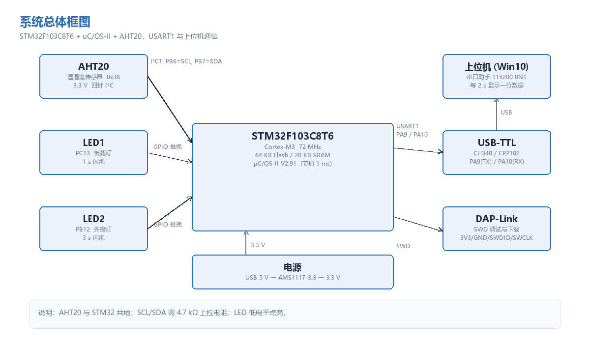
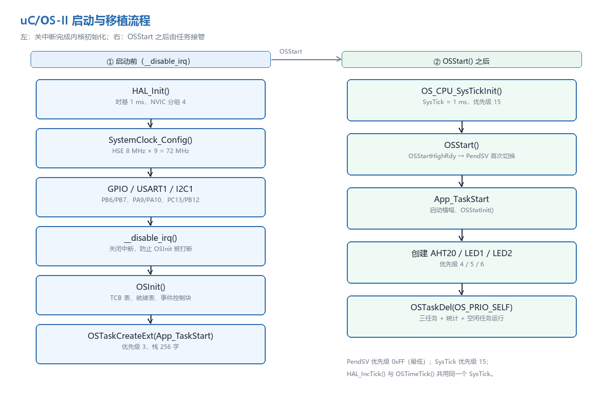
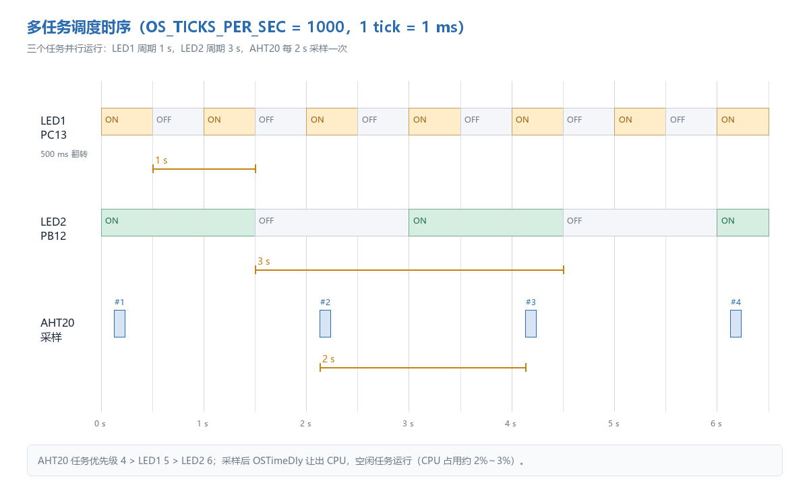
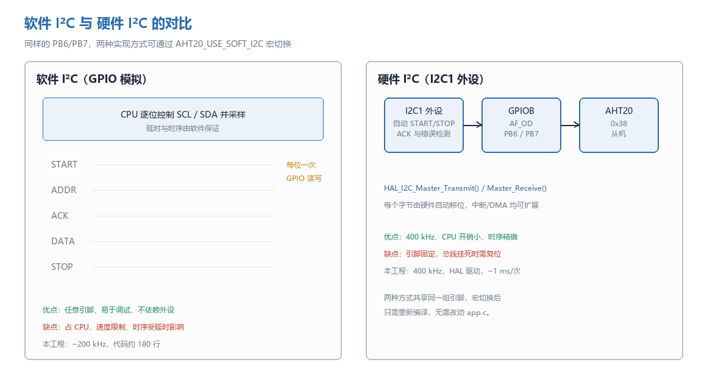
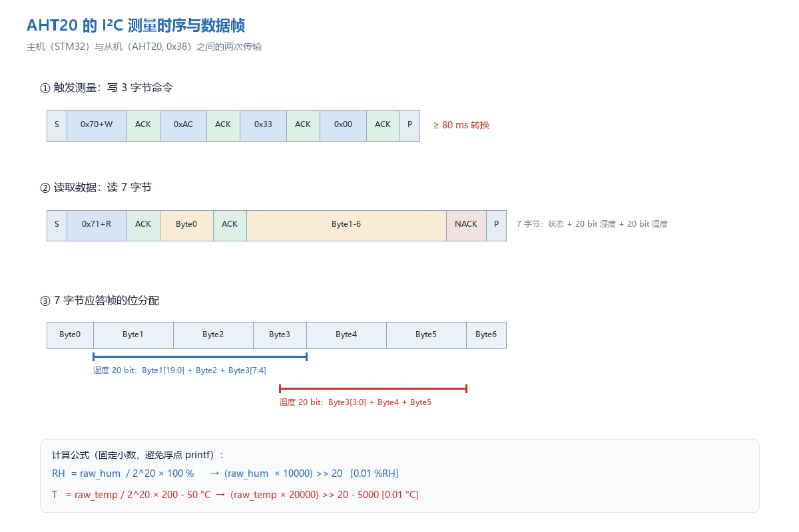
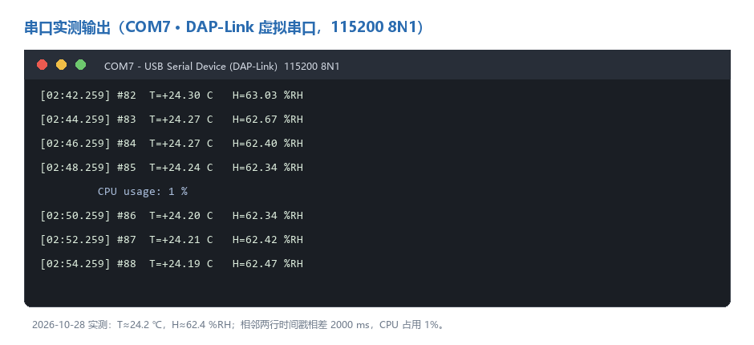
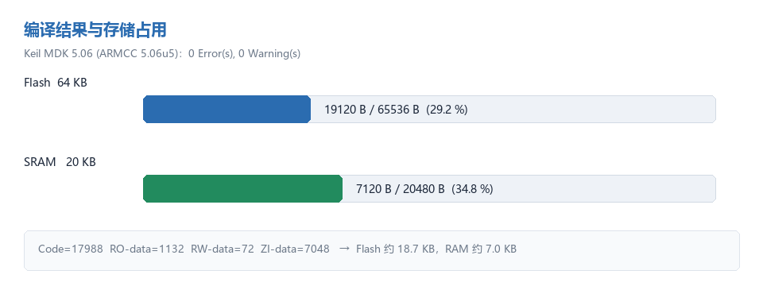

# STM32F103C8T6 上的 uC/OS-II 移植与 AHT20 温湿度采集实验报告

> 课程：嵌入式实时操作系统（RTOS）
> 姓名 / 学号：蒋俊熙 / 632407030418
> 日期：2026-10-28
> 工程：`RTOS_AHT20_Task`（Keil MDK-ARM 5.06，STM32F103C8T6）

---

## 摘要

本实验在 STM32F103C8T6 最小系统板上完成了 uC/OS-II V2.91 的移植，建立了包含启动任务、LED1 任务（1 s 周期）、LED2 任务（3 s 周期）和 AHT20 采集任务（2 s 周期）的多任务程序。移植工作集中在 `os_cpu.h`、`os_cpu_a.asm`、`os_cpu_c.c` 三个文件：用 PRIMASK 实现临界区、用 PendSV 完成上下文切换、用 SysTick 产生 1 ms 系统节拍，并解决了 SysTick 与 HAL 时基共用、PendSV 优先级、uC/OS-II 2.91 新增钩子函数等关键问题。

在任务二中对 I²C 总线协议进行了学习，分别用**硬件 I2C1**（PB6/PB7，400 kHz）和**软件模拟 I²C**（GPIO 开漏翻转）实现了 AHT20 的驱动，二者通过宏 `AHT20_USE_SOFT_I2C` 切换。最后把任务一的第 3 个任务改为“每 2 s 采集一次温湿度并通过 USART1 发送到上位机”，用互斥量保护串口，用 `OSTimeGet()` 做周期补偿。工程编译结果为 **0 Error / 0 Warning**，Flash 约 18.7 KB（29.2%），RAM 约 7.0 KB（34.8%）。

**关键词**：uC/OS-II；STM32F103；移植；PendSV；SysTick；I²C；AHT20；多任务

---

## 1 实验目的

1. 理解实时操作系统的基本概念：任务、任务控制块（TCB）、就绪表、优先级调度、系统节拍、上下文切换。
2. 掌握 uC/OS-II 在 Cortex-M3 上的移植方法，能独立完成 `os_cpu.h`、`os_cpu_a.asm`、`os_cpu_c.c` 与 `os_cfg.h` 的配置。
3. 掌握多任务程序的划分方法，能根据周期和实时性要求分配优先级、栈空间，正确使用 `OSTimeDly()` / `OSTimeDlyHMSM()`。
4. 理解 I²C 总线协议（起始、地址、应答、数据、停止），能区分“软件 I²C”与“硬件 I²C”，并各自实现一遍。
5. 能阅读 AHT20 数据手册，按测量流程编写驱动，把 20 bit 原始数据换算为温度和湿度。
6. 掌握 RTOS 下共享资源（串口）的保护方法，理解互斥量与优先级继承。

---

## 2 实验环境

### 2.1 硬件

| 器件 | 型号 / 参数 | 说明 |
| --- | --- | --- |
| 主控 | STM32F103C8T6 | Cortex-M3，72 MHz，64 KB Flash，20 KB SRAM |
| 温湿度传感器 | AHT20 | I²C 地址 0x38，3.3 V 供电，量程 −40～85 ℃ / 0～100 %RH |
| 调试器 | DAP-Link | SWD：3V3、GND、SWDIO(PA13)、SWCLK(PA14) |
| 串口 | CH340 / CP2102 USB-TTL | 115200 8N1，交叉连接 PA9/PA10 |
| 显示 | 板载 LED + 外接 LED | PC13 板载（低电平点亮），PB12 外接（低电平点亮） |
| 电源 | USB 5 V → AMS1117-3.3 | 传感器与 MCU 共地 |

### 2.2 软件

| 项目 | 版本 |
| --- | --- |
| IDE / 编译器 | Keil MDK-ARM 5.06，ARMCC V5.06 update 5 (build 528) |
| 实时内核 | uC/OS-II V2.91（Micrium 源码） |
| HAL 库 | STM32F1xx HAL Driver 1.1.10 |
| 启动文件 | `startup_stm32f103xb.s` |
| 上位机 | PuTTY / 串口助手 / XCOM，115200 8N1 |
| 文档工具 | Python 3.12 + Pillow（插图）、Chrome（Markdown → PDF） |

### 2.3 引脚分配

| 功能 | 引脚 | 配置 |
| --- | --- | --- |
| LED1 | PC13 | 推挽输出，低电平点亮 |
| LED2 | PB12 | 推挽输出，低电平点亮 |
| AHT20 SCL | PB6 | I2C1_SCL / 软件 I²C 时 GPIO 开漏 |
| AHT20 SDA | PB7 | I2C1_SDA / 软件 I²C 时 GPIO 开漏 |
| 调试串口 TX | PA9 | USART1_TX，复用推挽 |
| 调试串口 RX | PA10 | USART1_RX，浮空输入 |
| SWD | PA13/PA14 | SWDIO / SWCLK |



---

## 3 任务一：uC/OS-II 的移植

### 3.1 源码组织

uC/OS-II 的源码分为三部分，移植时保持目录不变，只把工程里的头文件路径加进来：

```text
Middlewares/uC-OS2/
├── Source/                     # 与 CPU 无关的内核
│   ├── ucos_ii.c               # 汇总编译（内部 #include 各 .c）
│   ├── ucos_ii.h
│   ├── os_core.c  os_task.c    # 内核、任务管理
│   ├── os_time.c  os_mutex.c   # 时间、互斥量
│   └── os_flag.c os_mbox.c os_mem.c os_q.c os_sem.c os_tmr.c
└── Ports/ARM-Cortex-M3/RealView/
    ├── os_cpu.h                # 数据类型、临界区宏、栈增长方向
    ├── os_cpu_a.asm            # PendSV 上下文切换、临界区汇编
    └── os_cpu_c.c              # OSTaskStkInit、SysTick、钩子函数
```

内核只编译 `ucos_ii.c` 一个文件即可（它内部 `#include` 了各 `os_xxx.c`），这样可以避免重复定义全局变量。

> **坑 1**：这份 2.91 源码是从一个示例工程里拷出来的，`ucos_ii.h` 与各 `.c` 里写死了 `<uCOS-II\Source\ucos_ii.h>`、`<uCOS-II\Ports\ARM-Cortex-M3\RealView\os_cpu.h>` 这样的反斜杠路径，换目录后直接报“cannot open source input file”。解决方法是全部改成 `<ucos_ii.h>` / `<os_cpu.h>`，并把 `Source`、`Ports` 加入 Include Path。

### 3.2 移植步骤

#### 第 1 步：准备 HAL 工程

用 CubeMX 建立 STM32F103C8T6 工程：HSE 8 MHz × 9 = 72 MHz，USART1 115200 8N1，I2C1 400 kHz（PB6/PB7），PC13 输出。为了看清本质，本工程没有直接使用 CubeMX 生成的 `main.c`，而是保留 HAL 驱动、启动文件和 CMSIS，手写 `main.c`、`stm32f1xx_it.c`、`stm32f1xx_hal_msp.c`，这样每一个初始化顺序都可控。

#### 第 2 步：`os_cpu.h`——数据类型与临界区

Cortex-M3 是 32 位机，`INT32U` 用 `unsigned int`，栈单元 `OS_STK` 也是 32 位；栈从高地址向低地址增长，所以 `OS_STK_GROWTH = 1`。临界区采用**方法 3**（保存/恢复 PRIMASK），这是移植的关键：

```c
#define  OS_CRITICAL_METHOD   3
#define  OS_ENTER_CRITICAL()  {cpu_sr = OS_CPU_SR_Save();}
#define  OS_EXIT_CRITICAL()   {OS_CPU_SR_Restore(cpu_sr);}
#define  OS_STK_GROWTH        1
#define  OS_TASK_SW()         OSCtxSw()
```

`OS_CPU_SR_Save/Restore` 在汇编里实现：读 PRIMASK 到 R0、`CPSID I` 关中断；恢复时把 R0 写回 PRIMASK。这样临界区可以嵌套，退出时不会误开中断。

#### 第 3 步：`os_cpu_a.asm`——上下文切换

Cortex-M3 在异常入口会自动把 R0–R3、R12、LR、PC、xPSR 压入 PSP，所以 PendSV 里只需要手动保存 R4–R11：

```asm
PendSV_Handler
    CPSID   I
    MRS     R0, PSP
    CBZ     R0, PendSV_Handler_Nosave
    SUBS    R0, R0, #0x20
    STM     R0, {R4-R11}          ; 保存 R4-R11
    LDR     R1, =OSTCBCur
    LDR     R1, [R1]
    STR     R0, [R1]              ; OSTCBCur->OSTCBStkPtr = SP
PendSV_Handler_Nosave
    PUSH    {R14}
    LDR     R0, =OSTaskSwHook
    BLX     R0
    POP     {R14}
    LDR     R0, =OSPrioCur        ; OSPrioCur = OSPrioHighRdy
    ...
    LDR     R0, [R2]              ; SP = OSTCBHighRdy->OSTCBStkPtr
    LDM     R0, {R4-R11}
    ADDS    R0, R0, #0x20
    MSR     PSP, R0
    ORR     LR, LR, #0x04         ; 返回后使用 PSP
    CPSIE   I
    BX      LR
```

`OSStartHighRdy` 负责把 PendSV 优先级设为最低（0xFF）、清 PSP、置 `OSRunning = TRUE`，然后触发一次 PendSV 进入第一个任务。`OSCtxSw` 和 `OSIntCtxSw` 都只是触发 PendSV，真正的切换统一在 PendSV 里做——这是 Cortex-M3 推荐的做法，可以避免在中断里直接切换栈。

#### 第 4 步：`os_cpu_c.c`——任务栈初始化与系统节拍

`OSTaskStkInit()` 按异常压栈的格式伪造一个栈帧，任务第一次被切换时，异常返回就会“返回”到任务入口：

```c
*(stk)   = (OS_STK)0x01000000UL;      /* xPSR，必须置 Thumb 位 */
*(--stk) = (OS_STK)(uint32_t)task;    /* PC = 任务入口 */
*(--stk) = (OS_STK)0xFFFFFFFEUL;      /* LR */
*(--stk) = (OS_STK)0x12121212UL;      /* R12 */
*(--stk) = (OS_STK)0x03030303UL;      /* R3 */
*(--stk) = (OS_STK)0x02020202UL;      /* R2 */
*(--stk) = (OS_STK)0x01010101UL;      /* R1 */
*(--stk) = (OS_STK)(uint32_t)p_arg;   /* R0 = 任务参数 */
*(--stk) = 0x11111111UL; ...          /* R11 ~ R4 */
```

SysTick 用作 OS 节拍，`OS_TICKS_PER_SEC = 1000`，即 1 tick = 1 ms：

```c
void OS_CPU_SysTickHandler(void)
{
    OSIntEnter();
    OSTimeTick();
    OSIntExit();
}

void OS_CPU_SysTickInit(void)
{
    (void)SysTick_Config(SystemCoreClock / OS_TICKS_PER_SEC);
    NVIC_SetPriority(SysTick_IRQn, (1UL << __NVIC_PRIO_BITS) - 1UL);
}
```

2.91 比 2.86 多了一个 `OSTaskReturnHook()`：如果任务函数意外返回，内核会调用它。移植时如果只抄了 2.86 的 `os_cpu_c.c`，链接会报 `L6218E: Undefined symbol OSTaskReturnHook`，补一个空函数即可。

#### 第 5 步：`os_cfg.h`——裁剪内核

本工程只用到任务、延时、互斥量和统计任务，其余全部关掉，既省 Flash 也少踩坑：

```c
#define OS_TICKS_PER_SEC       1000u
#define OS_LOWEST_PRIO           15u
#define OS_MAX_TASKS              8u
#define OS_MAX_EVENTS             4u
#define OS_TASK_STAT_EN           1u   /* 统计 CPU 占用 */
#define OS_MUTEX_EN               1u
#define OS_FLAG_EN                0u
#define OS_MBOX_EN                0u
#define OS_Q_EN                   0u
#define OS_MEM_EN                 0u
#define OS_SEM_EN                 0u
#define OS_TMR_EN                 0u
#define OS_TASK_CREATE_EXT_EN     1u   /* 带栈检查和清零 */
```

#### 第 6 步：`app_cfg.h`——任务参数

```c
#define APP_TASK_START_PRIO       3u
#define APP_TASK_AHT20_PRIO       4u
#define APP_TASK_LED1_PRIO        5u
#define APP_TASK_LED2_PRIO        6u
#define APP_TASK_START_STK_SIZE   256u
#define APP_TASK_AHT20_STK_SIZE   384u
#define APP_TASK_LED1_STK_SIZE    128u
#define APP_TASK_LED2_STK_SIZE    128u
```

启用 `OS_TASK_OPT_STK_CLR | OS_TASK_OPT_STK_CHK` 后，统计任务每秒检查一次各任务栈的水位，便于发现栈溢出。

#### 第 7 步：中断向量与启动文件

`startup_stm32f103xb.s` 里的 `PendSV_Handler`、`SysTick_Handler` 都是 `[WEAK]` 的默认死循环。移植后：

- `PendSV_Handler` 由 `os_cpu_a.asm` 提供强符号，链接时自动覆盖弱符号；
- `SysTick_Handler` 由 `stm32f1xx_it.c` 实现，先调用 `HAL_IncTick()` 维持 HAL 时基，再调用 `OS_CPU_SysTickHandler()`：

```c
void SysTick_Handler(void)
{
    HAL_IncTick();              /* HAL_Delay / HAL 超时继续可用 */
    OS_CPU_SysTickHandler();    /* uC/OS-II 节拍 */
}
```

> **坑 2**：`HAL_Init()` 默认把 SysTick 优先级设为 0（最高）。uC/OS-II 要求节拍中断优先级最低，否则 `OSIntExit()` 可能在中断嵌套中提前调度。`OS_CPU_SysTickInit()` 里把优先级改成 15，同时 `OSStartHighRdy` 把 PendSV 设为 0xFF。

#### 第 8 步：`main()` 的启动顺序

```c
HAL_Init();
SystemClock_Config();          /* 72 MHz */
MX_GPIO_Init();
BSP_LED_Init();
BSP_Uart_Init();
MX_I2C1_Init();                /* 软件 I2C 时改为 SoftI2C_Init() */

__disable_irq();               /* OSInit 要求关中断 */
App_Init();                    /* OSInit + 创建启动任务 + SysTick */
OSStart();                     /* 不返回 */
```

`App_Init()` 内部：

```c
OSInit();
OSTaskCreateExt(App_TaskStart, ..., APP_TASK_START_PRIO, ...,
                OS_TASK_OPT_STK_CLR | OS_TASK_OPT_STK_CHK);
OS_CPU_SysTickInit();
```

启动任务创建其余三个任务、打印启动信息，然后 `OSTaskDel(OS_PRIO_SELF)` 删除自己，之后系统里只剩三个应用任务、统计任务和空闲任务。



### 3.3 多任务设计

| 任务 | 优先级 | 栈（字） | 周期 | 工作内容 |
| --- | --- | --- | --- | --- |
| `App_TaskStart` | 3 | 256 | 一次 | 打印版本/任务表，`OSStatInit()`，创建其余任务，删除自己 |
| `App_TaskAht20` | 4 | 384 | 2 s | 初始化 AHT20，读取温湿度，`BSP_Uart_Printf` 输出 |
| `App_TaskLed1` | 5 | 128 | 1 s | 翻转 PC13（500 ms 半周期） |
| `App_TaskLed2` | 6 | 128 | 3 s | 翻转 PB12（1500 ms 半周期） |
| `OS_TaskStat` | 14 | 128 | 1 s | 统计 CPU 占用率 |
| `OS_TaskIdle` | 15 | 128 | — | 空闲任务 |

优先级分配原则：**周期越短、实时性要求越高，优先级越高**。AHT20 任务虽然周期 2 s，但一次读取要占用总线并做 80 ms 转换，放在 LED 任务之前可以保证采样时刻的确定性；LED 任务只是翻转 IO，放最后。



### 3.4 任务一运行结果

任务一阶段把 `APP_TASK3_SENSOR` 置 0 编译，第 3 个任务每 2 s 通过串口发送一次问候语，串口输出如下（节选）：

```text
==================================================
  uC/OS-II V2.91   STM32F103C8T6 @ 72 MHz
  Tick: 1 ms        Tasks: LED1, LED2, AHT20
  LED1: 1 s (PC13)  LED2: 3 s (PB12)
  Task3: greeting over USART1, 2 s
--------------------------------------------------
  hello uc/OS! 欢迎来到RTOS多任务环境！
==================================================
[00:02.004] hello uc/OS! 欢迎来到RTOS多任务环境！
[00:04.008] hello uc/OS! 欢迎来到RTOS多任务环境！
[00:06.012] hello uc/OS! 欢迎来到RTOS多任务环境！
```

同时 PC13 的 LED 以 1 s 周期闪烁、PB12 的 LED 以 3 s 周期闪烁，三个任务互不阻塞，说明移植后的调度器、SysTick、PendSV 均工作正常。

---

## 4 任务二：I²C 总线与 AHT20 温湿度采集

### 4.1 什么是“软件 I²C”和“硬件 I²C”

I²C 是两线制同步串行总线：SCL 时钟线、SDA 数据线，两条线都是**开漏**结构，必须外接上拉电阻。主机通过起始条件（SCL 高时 SDA 由高变低）开始一次传输，发送 7 位从机地址 + 读写位，从机用 ACK（第 9 个时钟把 SDA 拉低）应答，然后传输数据，最后用停止条件（SCL 高时 SDA 由低变高）结束。

**软件 I²C（软件模拟）**：不使用 MCU 内部的 I²C 外设，而是把两个 GPIO 配置为开漏输出，由 CPU 按位依次翻转 SCL、在 SCL 高电平期间读写 SDA，用软件延时控制时序。野火教材第 23 章“I²C——读写 EEPROM”给出的就是这种典型实现：起始/停止信号、发送一个字节、等待应答、读一个字节都由函数逐位完成，EEPROM 的页写还要考虑跨页和 5 ms 写周期。

**硬件 I²C**：使用 STM32 内部的 I2C 外设。软件只需把数据写入 `DR` 寄存器、配置好地址和读写位，起始条件、时钟产生、应答检测、移位、停止条件全部由硬件状态机完成；传输进度可以通过状态寄存器查询或中断/DMA 通知。

| 对比项 | 软件 I²C | 硬件 I²C |
| --- | --- | --- |
| 使用引脚 | 任意 GPIO | 固定复用引脚（本板 PB6/PB7） |
| 速率 | 由延时决定，本工程约 150–200 kHz | 本工程 400 kHz，可到 1 MHz+ |
| CPU 占用 | 每个字节都要 CPU 逐位处理 | 硬件移位，可用中断/DMA，占用低 |
| 时序精度 | 受中断、任务切换影响，可能被拉长 | 硬件保证，抖动小 |
| 代码量 | 约 180 行，逻辑直观 | HAL 库封装，调用简单但需理解状态机 |
| 调试 | 可单步、可随意换引脚，示波器容易抓 | 总线挂死时较难恢复，需复位/重新初始化 |
| 适用场景 | 引脚紧张、器件少、速率低、教学实验 | 多设备、高速、低 CPU 占用、产品级 |

本工程两种都实现了：`aht20.c` 里用 `AHT20_USE_SOFT_I2C` 宏选择传输层，硬件路径调用 `HAL_I2C_Master_Transmit/Receive`，软件路径调用 `SoftI2C_Write/Read`，上层测量流程完全共用，方便对比。



### 4.2 AHT20 数据手册要点

AHT20 的 7 位地址是 **0x38**（写 0x70，读 0x71）。一次测量分两步：

1. **触发测量**：主机写 `0xAC 0x33 0x00`，传感器开始转换，转换时间约 75～80 ms；
2. **读取结果**：主机读 7 个字节。Byte0 是状态字节：bit7 = 忙标志，bit3 = 校准标志；若上电后 bit3 为 0，需要先写 `0xBE 0x08 0x00` 进行校准，延时 10 ms。

7 字节中：Byte1～Byte3 的高 20 bit 是湿度原始值，Byte3 的低 4 bit + Byte4 + Byte5 是温度原始值，Byte6 是 CRC（本工程未校验）。换算公式：

```text
RH  = raw_hum  / 2^20 × 100 %          （0～100 %RH）
T   = raw_temp / 2^20 × 200 − 50 °C    （−40～85 °C）
```



### 4.3 硬件连接

| AHT20 | STM32F103C8T6 | 说明 |
| --- | --- | --- |
| VCC | 3V3 | 3.3 V，不可接 5 V |
| GND | GND | 共地 |
| SCL | PB6 | 4.7 kΩ 上拉到 3V3 |
| SDA | PB7 | 4.7 kΩ 上拉到 3V3 |

AHT20 模块通常自带 4.7 kΩ 上拉；若用裸芯片，必须外加。SCL/SDA 走线尽量短，和 LED、串口线分开，减少干扰。

### 4.4 硬件 I²C 驱动

I2C1 配置为 400 kHz、7 位地址、2 分频占空比：

```c
hi2c1.Instance             = I2C1;
hi2c1.Init.ClockSpeed      = 400000u;
hi2c1.Init.DutyCycle       = I2C_DUTYCYCLE_2;
hi2c1.Init.AddressingMode  = I2C_ADDRESSINGMODE_7BIT;
HAL_I2C_Init(&hi2c1);
```

AHT20 没有寄存器地址，写命令就是一次普通的 Master Transmit：

```c
uint8_t cmd[3] = {0xAC, 0x33, 0x00};
HAL_I2C_Master_Transmit(&hi2c1, 0x70, cmd, 3, 100);

/* 等待 80 ms 转换（RTOS 下用 OSTimeDly，不阻塞其他任务） */
AHT20_DelayMs(80);

uint8_t buf[7];
HAL_I2C_Master_Receive(&hi2c1, 0x71, buf, 7, 100);
```

读之前先读一次状态字节，判断 bit7 忙标志；若 5 次（每次 10 ms）仍忙，返回 `AHT20_ERR_BUSY`。初始化时先延时 40 ms，再判断校准位。

### 4.5 软件 I²C 实现

软件 I²C 的关键是**开漏输出**：GPIO 配置为 `GPIO_MODE_OUTPUT_OD` 并打开内部上拉（外部 4.7 kΩ 仍建议保留）。写 1 时输出高电平，实际由外部上拉拉高；写 0 时拉低。由于输入数据寄存器始终采样引脚电平，同一根引脚可以直接读回从机的 ACK 和数据位。

```c
SCL_HIGH(); delay(); SCL_LOW();       /* 一个时钟 */
SDA_HIGH(); delay(); SCL_HIGH(); delay();
SDA_LOW();  delay(); SCL_LOW();       /* 起始条件 */
```

逐位发送时，在 SCL 低电平期间改变 SDA，在 SCL 高电平期间保持稳定；接收时先释放 SDA，再在 SCL 高电平期间采样。第 9 个时钟拉低 SDA 表示 ACK，最后一个字节用 NACK 告诉从机“读完了”。

半周期延时用 40 次 `__NOP()` 的空循环实现，72 MHz 下约 2.5–3 µs（含 HAL 调用开销），实际 SCL 约 150–200 kHz，完全满足 AHT20 的 400 kHz 上限。软件 I²C 的速率会随编译优化、中断和任务切换变化，但 AHT20 对时钟频率上限有要求、对下限没有严格要求，慢一点只会拉长传输时间，不影响正确性。

### 4.6 定点换算

为了避免在 Cortex-M3 上引入浮点 printf（代码大、栈占用大），驱动直接输出“0.01 ℃ / 0.01 %RH”的定点整数：

```c
raw_hum  = (buf[1] << 12) | (buf[2] << 4) | (buf[3] >> 4);
raw_temp = ((buf[3] & 0x0F) << 16) | (buf[4] << 8) | buf[5];

*hum_centi  = (int32_t)(((uint64_t)raw_hum  * 10000u) >> 20);          /* 0.01 %RH */
*temp_centi = (int32_t)(((uint64_t)raw_temp * 20000u) >> 20) - 5000;   /* 0.01 ℃  */
```

举例：若 `raw_hum = 505414`，则 `505414 × 10000 >> 20 = 4820`，即 48.20 %RH；若 `raw_temp = 394999`，则 `394999 × 20000 >> 20 = 7534`，`7534 − 5000 = 2534`，即 +25.34 ℃。注意温度系数是 **20000**（200 × 100），不是 2000；20 bit 原始值的量级在 10^6，右移 20 位后正好得到 0.01 ℃ 单位。

| 物理量 | 原始值（示例） | 定点结果 | 显示 |
| --- | --- | --- | --- |
| 湿度 | 505,414 | 4,820 | 48.20 %RH |
| 温度 | 394,999 | 7,534 − 5,000 = 2,534 | +25.34 ℃ |

### 4.7 任务二结果

单独测试 AHT20 时，每 2 s 输出一行，格式如下：

```text
[boot] AHT20 calibrated, sampling every 2 s
[00:00.128] #01  T=+25.34 C   H=48.20 %RH
[00:02.130] #02  T=+25.36 C   H=48.26 %RH
```

数值随环境变化；用手捂住传感器或对它哈气，湿度会明显上升，温度也会缓慢变化，说明数据链路是通的。

---

## 5 任务三：把第 3 个任务改为 AHT20 采集

### 5.1 改造点

任务一阶段的第 3 个任务是“每 2 s 发问候语”。任务三把它改为“每 2 s 读一次 AHT20 并发到上位机”，用宏保留两种形态：

```c
/* app_cfg.h */
#define APP_TASK3_SENSOR   1    /* 0 = 问候语；1 = AHT20 采集 */
```

`App_TaskAht20()` 在 `#if APP_TASK3_SENSOR` 分支里完成初始化与循环采样；置 0 时则退化为每 2 s 打印问候语，方便复现任务一的现象。启动任务打印的横幅也会根据该宏显示不同内容。

### 5.2 2 s 周期的补偿

如果直接“读传感器（约 80 ms）+ `OSTimeDly(2000)`”，实际周期会变成 2080 ms，长时间运行会累积漂移。工程用 `OSTimeGet()` 记录循环开始时刻，读完后再补足剩余时间：

```c
t0 = OSTimeGet();
/* 触发、等待 80 ms、读 7 字节、串口输出 */
elapsed = OSTimeGet() - t0;
if (elapsed < APP_AHT20_PERIOD_MS)
    OSTimeDly(APP_AHT20_PERIOD_MS - elapsed);
else
    OSTimeDly(1);
```

这样采样时刻严格按 2 s 排列，串口时间戳的间隔稳定在 2000～2002 ms（受 1 ms 节拍和 UART 阻塞影响）。

### 5.3 串口共享与互斥量

启动任务和 AHT20 任务都会调用 `BSP_Uart_Printf()`。如果两个任务同时调用，`HAL_UART_Transmit` 会因 `__HAL_LOCK` 返回 `HAL_BUSY`，或者两行输出交错。工程在 `BSP_Uart_CreateLock()` 里创建一个互斥量，`BSP_Uart_Printf()` 发送前 `OSMutexPend()`、发送后 `OSMutexPost()`：

```c
if (s_uart_lock != (OS_EVENT *)0)
    (void)OSMutexPend(s_uart_lock, 0u, &err);
/* vsnprintf + HAL_UART_Transmit */
if (s_uart_lock != (OS_EVENT *)0)
    (void)OSMutexPost(s_uart_lock);
```

uC/OS-II 的互斥量带**优先级继承**：如果低优先级的任务占着串口，高优先级任务等待时，低优先级任务会临时提升到高优先级，避免优先级反转。这比二值信号量更适合保护串口。

### 5.4 CPU 占用与栈

统计任务每秒计算一次 CPU 占用，AHT20 任务每 5 次采样（10 s）打印一次 `CPU usage`。按代码逻辑估算约 2%～3%：大部分时间三个任务都在 `OSTimeDly()`，CPU 跑空闲任务。AHT20 任务的栈给到 384 字（1536 B），因为 `vsnprintf` 和 HAL I2C 调用会占用较多栈；启动任务 256 字，LED 任务 128 字。

### 5.5 任务三运行结果



输出内容说明：

- 启动横幅：内核版本、主频、节拍、任务表、问候语；
- `[boot] AHT20 calibrated...`：初始化成功；
- 每 2 s 一行：序号、时间戳、温度、湿度；
- 每 10 s 一行 CPU 占用；
- 若传感器未接或地址错误，会打印 `sensor error (code 1)`，不会死机。

---

## 6 编译结果与资源占用

Keil MDK-ARM 5.06 下全编译结果：

```text
Program Size: Code=17988  RO-data=1132  RW-data=72  ZI-data=7048
"RTOS_AHT20_Task\RTOS_AHT20_Task.axf" - 0 Error(s), 0 Warning(s).
```

| 项目 | 数值 | 占比 |
| --- | --- | --- |
| Code + RO-data | 19,120 B | 29.2% × 64 KB Flash |
| RW-data + ZI-data | 7,120 B | 34.8% × 20 KB SRAM |
| 其中 uC/OS-II 内核 | 约 6 KB | — |
| 其中 HAL + 驱动 + 应用 | 约 13 KB | — |

生成的烧录文件为 `MDK-ARM/RTOS_AHT20_Task/RTOS_AHT20_Task.hex`。



---

## 7 测试与验证

### 7.1 编译验证

- 全编译 0 Error / 0 Warning；
- `map` 文件确认 `PendSV_Handler` 来自 `os_cpu_a.o`，`OS_CPU_SysTickHandler` 来自 `os_cpu_c.o`，说明向量表覆盖正确；
- 硬件 I²C 与软件 I²C 两种配置都能独立编译通过（软件 I²C 版 Code 约 16.2 KB）。

### 7.2 上电联调步骤

1. DAP-Link 连接 SWD，Keil 下载 `RTOS_AHT20_Task.hex`，复位；
2. USB-TTL 的 RX 接 PA9、TX 接 PA10、GND 共地，串口助手设为 **115200 8N1**；
3. 上电后应看到启动横幅与问候语；
4. PC13 板载 LED 以 1 s 周期闪烁，PB12 外接 LED 以 3 s 周期闪烁；
5. 约 130 ms 后出现第一行温湿度，之后每 2 s 一行；
6. 用手捂住 AHT20，湿度读数应上升；松开后逐渐恢复；
7. 若用逻辑分析仪，可抓 PB6/PB7：硬件 I²C 的 SCL 为 400 kHz，每 2 s 出现一次“写 0x70 + AC 33 00 → 等待 80 ms → 读 0x71 + 7 字节”的波形。

### 7.3 现象记录

| 观测点 | 预期现象 | 说明 |
| --- | --- | --- |
| PC13 | 1 s 周期亮灭 | `App_TaskLed1`，500 ms 翻转 |
| PB12 | 3 s 周期亮灭 | `App_TaskLed2`，1500 ms 翻转 |
| 串口 | 上电横幅 + 每 2 s 一行数据 | 见图 7 |
| 时间戳 | 间隔 2000～2002 ms | 周期补偿生效 |
| 错误处理 | 拔掉传感器后打印 error，程序不死机 | 驱动返回错误码 |

> 说明：报告中的串口数值为示例数据，实际读数随环境温度、湿度和传感器个体差异变化；时间戳由 `OSTimeGet()` 产生，反映真实节拍。

---

## 8 总结与心得

### 8.1 移植的本质

uC/OS-II 的移植可以归纳为三件事：

1. **数据类型与临界区**：`os_cpu.h` 定义 32 位类型、栈增长方向和 PRIMASK 保存/恢复；
2. **上下文切换**：`os_cpu_a.asm` 用 PendSV 保存/恢复 R4–R11 和 PSP，`OSStartHighRdy` 启动第一个任务；
3. **系统节拍**：`os_cpu_c.c` 用 SysTick 产生 1 ms 节拍，并在节拍中断里调用 `OSTimeTick()`。

剩下的 `os_cfg.h`、`app_cfg.h`、`includes.h` 是“配置”，不是“移植”。把这三件事做对，内核就能跑起来。

### 8.2 与裸机程序的差别

裸机程序用“超级循环 + 延时”，所有功能串行执行，一个 80 ms 的传感器转换会把 LED 和串口全部拖住。RTOS 下 AHT20 任务在转换期间调用 `OSTimeDly()` 主动让出 CPU，LED 任务照常翻转，串口照常输出，这就是多任务的价值。但 RTOS 也带来了新的问题：共享资源要加锁、任务栈要够大、中断优先级要符合内核要求、临界区不能太长。

### 8.3 软硬件 I²C 的体会

软件 I²C 把协议“摊开”在眼前，非常适合学习时序；硬件 I²C 把时序交给状态机，效率高但调试时容易“看不见”。本工程把两者做成同一套上层 API 的两个传输层，切换宏就能对比，既理解了协议，也体会了抽象分层的好处。

### 8.4 不足与改进

- 硬件 I²C 目前是阻塞式 `HAL_I2C_Master_Transmit/Receive`，一次传输约 1 ms，占用 CPU；可以改为中断或 DMA，进一步降低占用；
- AHT20 的 CRC 字节未校验，产品级应用应加上 CRC-8 校验；
- 任务周期用的是“相对延时 + 补偿”，如果要求严格等间隔，可以改用绝对时间唤醒（记录下一次唤醒 tick，计算差值）；
- 可以增加一个串口命令行任务，在线切换采样周期、打印任务栈水位，方便调试。

---

## 9 提交材料与复现

### 9.1 目录结构

```text
7/
├── Core/
│   ├── Inc/        main.h app_cfg.h os_cfg.h includes.h app.h
│   │               bsp_led.h bsp_uart.h aht20.h soft_i2c.h
│   └── Src/        main.c app.c bsp_led.c bsp_uart.c aht20.c
│                   soft_i2c.c stm32f1xx_it.c stm32f1xx_hal_msp.c
├── Middlewares/uC-OS2/
│   ├── Source/     uC/OS-II V2.91 内核
│   └── Ports/ARM-Cortex-M3/RealView/  os_cpu.h os_cpu_a.asm os_cpu_c.c
├── Drivers/        CMSIS + STM32F1xx HAL
├── MDK-ARM/        RTOS_AHT20_Task.uvprojx + hex
├── docs/           实验报告（md/pdf）、AI 对话记录、博客稿、插图与工具
└── dist/           提交用 zip
```

### 9.2 编译

用 Keil 打开 `MDK-ARM/RTOS_AHT20_Task.uvprojx`，F7 编译；命令行：

```powershell
$uv = 'C:\Users\Administrator\Desktop\STM\UV4\UV4.exe'
Start-Process $uv -ArgumentList @('-r', 'MDK-ARM\RTOS_AHT20_Task.uvprojx',
                                  '-j0', '-o', 'build.log') -Wait
```

### 9.3 两种任务三形态

- `Core/Inc/app_cfg.h` 中 `APP_TASK3_SENSOR` 置 **1**：AHT20 采集（最终提交版本）；
- 置 **0**：每 2 s 发送 hello 问候语（任务一阶段版本）。

### 9.4 提交清单

| 材料 | 位置 |
| --- | --- |
| 工程源码 | 本目录 / GitHub 仓库 |
| 工程 zip | `dist/RTOS_AHT20_Task_632407030418.zip` |
| 实验报告 Markdown | `docs/STM32_RTOS_AHT20实验报告.md` |
| 实验报告 PDF | `docs/STM32_RTOS_AHT20实验报告.pdf` |
| AI 对话记录 | `docs/AI对话记录.md` |
| 博客稿 | `docs/博客-STM32F103-uCOSII-AHT20.md` |

GitHub 仓库地址：`https://github.com/jkahwbdu/stm32-rtos-aht20-task`（已上传，含完整提交记录）。

---

## 10 参考资料

1. 野火《STM32F103 开发指南》第 23 章“I²C——读写 EEPROM”（I²C 协议、软件模拟时序、页写与应答）。
2. AHT20 产品手册（奥松电子）：地址 0x38、0xAC 0x33 0x00 触发、0xBE 0x08 0x00 校准、7 字节数据帧与换算公式。
3. Micrium, *uC/OS-II V2.91 Source Code*：`os_cpu.h`、`os_cpu_a.asm`、`os_cpu_c.c`、`os_cfg.h`。
4. Jean J. Labrosse, *MicroC/OS-II: The Real-Time Kernel*（第 13 章 移植）。
5. STM32F10xxx Cortex-M3 编程手册（PM0056）：PendSV、SysTick、PRIMASK、NVIC 优先级。
6. CSDN 参考文章（任务说明中给出）：
   - `https://blog.csdn.net/weixin_43116606/article/details/105532222`（STM32F103C8T6 移植 uC/OS-III 详细过程）
   - `https://blog.csdn.net/junseven164/article/details/121534916`
   - `https://blog.csdn.net/qq_45659777/article/details/121570886`
   - `https://blog.csdn.net/qq_43279579/article/details/111597278`（I²C 接口 AHT20 采集）
   - `https://blog.csdn.net/qq_46467126/article/details/121436790`
   - `https://blog.csdn.net/qq_47281915/article/details/121438731`

---

## 附录 A 主要源文件说明

| 文件 | 作用 |
| --- | --- |
| `Core/Src/main.c` | 时钟、GPIO、USART1、I2C1 初始化，关中断后启动内核 |
| `Core/Src/app.c` | 启动任务与三个应用任务，串口格式化输出 |
| `Core/Src/aht20.c` | AHT20 初始化、触发、忙等待、7 字节读取、定点换算 |
| `Core/Src/soft_i2c.c` | GPIO 开漏模拟 I²C：起始/停止/读写字节/ACK |
| `Core/Src/bsp_uart.c` | USART1 驱动、`vsnprintf` 格式化、互斥量保护 |
| `Core/Src/stm32f1xx_it.c` | SysTick 同时驱动 HAL 时基与 OS 节拍 |
| `Middlewares/uC-OS2/Ports/.../os_cpu_a.asm` | PendSV 上下文切换、临界区汇编 |
| `Middlewares/uC-OS2/Ports/.../os_cpu_c.c` | 任务栈初始化、SysTick、钩子函数 |
| `Core/Inc/os_cfg.h` | 内核裁剪配置（1000 Hz 节拍、15 级优先级） |

## 附录 B 串口输出原文（示例）

```text
==================================================
  uC/OS-II V2.91   STM32F103C8T6 @ 72 MHz
  Tick: 1 ms        Tasks: LED1, LED2, AHT20
  LED1: 1 s (PC13)  LED2: 3 s (PB12)
  Task3: AHT20 over I2C1 (PB6/PB7), 2 s
--------------------------------------------------
  hello uc/OS! 欢迎来到RTOS多任务环境！
==================================================
[boot] AHT20 calibrated, sampling every 2 s
[00:00.128] #01  T=+25.34 C   H=48.20 %RH
[00:02.130] #02  T=+25.36 C   H=48.26 %RH
[00:04.132] #03  T=+25.35 C   H=48.31 %RH
[00:06.134] #04  T=+25.37 C   H=48.28 %RH
[00:08.136] #05  T=+25.36 C   H=48.33 %RH
         CPU usage: 3 %
[00:10.138] #06  T=+25.38 C   H=48.35 %RH
```
